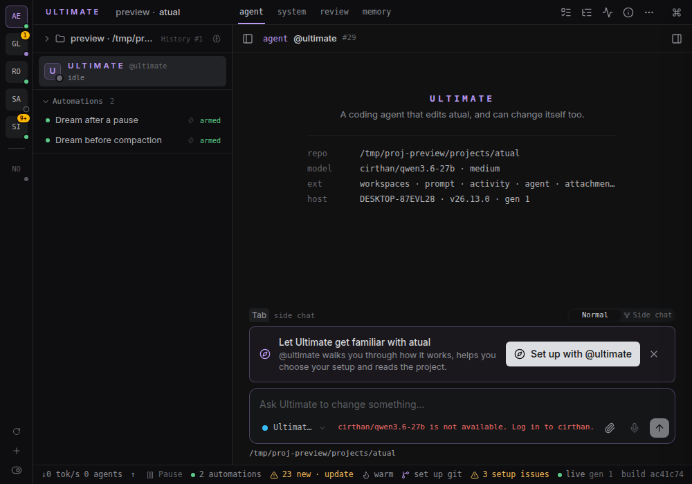
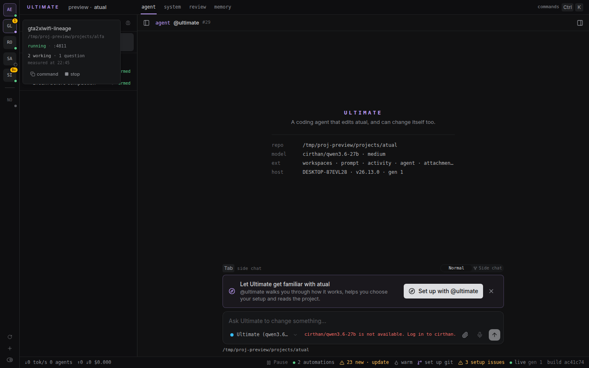
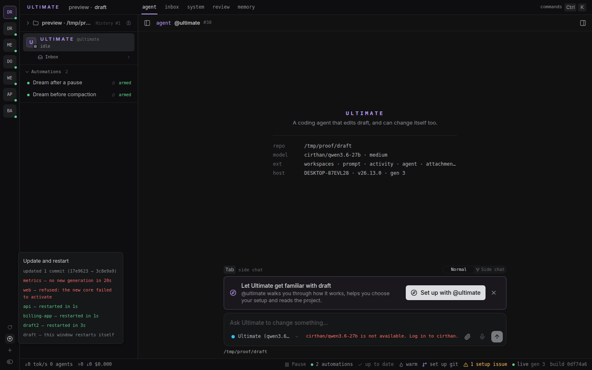
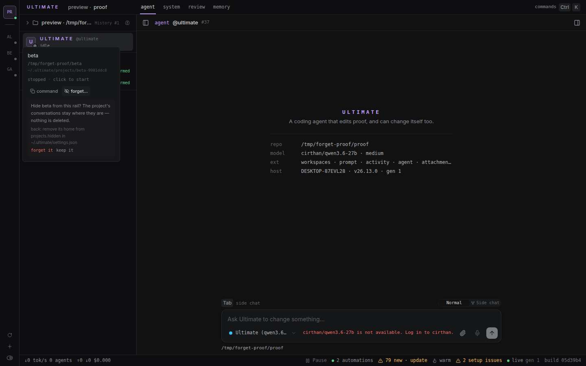

# projects — a rail of projects

A column on the left edge of the window, one tile per project: running hosts on top, stopped ones
below, each with a presence dot and the number of unanswered questions. One click opens a project or
brings it up. When the clone Ultimate runs from has moved — or a host of this machine is still running
the code from before it did — a button at the foot of the rail updates the clone once and restarts every
host that needs it.



## How it works

One tile per project, drawn with its initials (`billing-app` → `BA`). This window's project comes first,
then the other running ones, a thin line, then the stopped ones — and inside each group the tiles are a
**stack**: the project whose rail was opened last is the first tile, the one before it the second. That
is what makes going back easy: switch to another project to capture something, come back, and the project
you left is right below this one.

The order is the machine's, not a window's — every window of every project reads the same stamps
(`~/.ultimate/projects-shown.json`, below), so they all agree on what came before. A project this machine
has no stamp for is placed by when it opened, and two with neither are ordered by name. The price of
"always the second" is that a tile can change place: opening a project moves its tile up in the rails of
this machine, this window's included.

The dot in the corner is the project's state: grey stopped, green up and idle, pulsing while the last
reading saw it working, hollow when the host does not answer. The number in the corner is the count of
questions without an answer (`9+` from ten up), in amber.

A tile is one click: a running project opens in this tab, a stopped one is brought up.

Hovering or focusing a tile opens its panel after a moment, with what the tile does not fit: the port,
the state in words, how many conversations are working and how many questions wait, the command to
copy, the stop button and, on a stopped project, `forget…`. Those numbers are measured when the panel
opens, with the time of the reading.



On the phone there is no rail: the same list, compact, stays in the sidebar.

## Using it

- **Switch project** — click a running tile: it opens in this tab. ⌘/Ctrl+click opens a new tab, like
  any link.
- **Bring a stopped project up** — click its tile; it shows a spinner until the host answers. If it
  does not come up, the tile gains a red ring and the panel says why.
- **Stop a host** — the button in the tile's panel. A host this extension did not start (born in a
  terminal or in a supervisor) stops only after a confirmation, with the port and the pid in the
  question.
- **Create a project** — `+` at the bottom of the rail: type the folder's path, absolute or starting
  with `~`. The host comes up and its tile appears; the card offers `Open it`. Its first run, its
  onboarding and the trust decision happen in that project's own window. A folder whose project was
  forgotten comes back to the rail instead of being refused.
- **Refresh the projects** — `⟳` reads every project again now; each tile's panel says when its
  numbers were read.
- **Forget a project** — `forget…` in the panel of a stopped project (not this window's): the tile
  leaves the rail and the project's conversations stay where they are. Nothing is deleted; the panel
  says how to bring it back.
- **Turn the splash on or off** — the switch at the bottom of the rail. One click, and one click back.
- **Update and restart the machine** — the button at the bottom of the rail, beside `⟳`, which appears
  only when there is something to do. See below.

## Update and restart the machine

Every project window of this machine reads the same clone of Ultimate, so one update brings them all
forward — but each of them has to be *restarted* to run it, and the ones running `server/` code carry the
old code until then. One host can do that for all of them.

The button at the foot of the rail is there only when there is something to do, and its tooltip says what
(`Update and restart: update 5 commits · restart 2 projects`). One click does, in this order:

1. **Updates the clone once**, through Ultimate's own update: fetch, fast-forward, and an install when the
   lockfile asks for one. This extension never runs `git`, `pnpm` or the clone's lock itself. If the update
   **refuses** — uncommitted changes in the clone, another branch, a diverged branch, the lander landing —
   the refusal is shown whole and **nothing is restarted**: no host comes back onto a clone that did not
   move. (A clone with nothing to bring in is not updated at all, so a dirty checkout does not block the
   restarts.)
2. **Asks every host of the machine** whether it is still running code the clone has moved past, and puts
   the ones that are in the list.
3. **Restarts them one at a time**, never five at once, and waits for each: the supervisor type-checks the new
   core and answers only when it is prepared (up to two minutes), and the port keeps answering throughout the
   swap with the old process — so what counts as back is the generation that was announced actually serving,
   within 20 seconds. A host that does not get there is reported, never called ready.
4. **This window last**, through the SDK: the process answering the click cannot swap itself, so the window
   asks the core, which swaps and rolls back if the new one does not activate.

What came of it is a panel beside the button: the pull, one line per project (`billing-app — restarted in
4s`, `api — no answer in 20s`), and any rollback of this window. The same host on the same build is not
tried twice inside ten minutes — a host that came back still old for another reason turns up again later
instead of restarting in a loop.



What to keep in mind:

- **Restarting another window interrupts the turn running there.** The agent resumes from its checkpoint
  once the new process is up — nothing is lost, but the answer waits for the restart.
- **A host that does not come back stays red.** Its tile goes `unavailable` with the reason in the panel,
  and the summary says `no answer in 20s`. Nothing retries it on its own.
- **A dirty or diverged clone is not resolved here.** That is the update's refusal, and a diverged clone has
  its own `Update with @ultimate` card.
- **Nothing is pushed, and nothing is fetched by hand.** The button updates and restarts; it never touches
  your branches, and a project without a commit of its own is not affected.

## Configuration

Two keys of this machine's `~/.ultimate/settings.json` are this extension's: the splash switch and the
homes the rail hides. Everything else in the file stays as it is. A second file,
`~/.ultimate/projects-shown.json`, holds the order of the tiles; it is this extension's own, and the
settings file never mentions it.

### The order of the tiles

Every page load of the rail stamps its project, and that is all this file is:

```json
{ "/home/juliano/.ultimate/projects/billing-app-1a2b3c4d": 1770000000000 }
```

The key is the project's **home**, the same one the panel shows, and the value is when its rail was last
opened, in epoch ms. `list` reads it on every reading. `shown` keeps the 100 newest homes so the file does
not grow for ever, and writes it through a temporary and a `rename`. A file that cannot be read whole is
treated as empty — the rail is then ordered by when each project opened, without a word about it, and
nothing is rewritten. A home in the file that is not a project of this machine any more is simply not
used. Deleting the file is safe: the order starts from scratch and rebuilds itself as the windows are
opened.

### The splash animation

```json
{ "extensions": { "disable": ["splash"] } }
```

The switch flips that entry: off adds `splash`, on removes it, and every other key of the file stays as
it is. With no file there, turning it off creates the file. The file is rewritten as normalised JSON —
the old formatting is lost, no key is.

Writing it by hand has the same effect: a different set of extensions means a new web bundle, so
**every open window reloads**. The switch's tooltip says so. To undo, remove `splash` from the list and
save, or click the switch again.

A project's `.ultimate/settings.json` can say the opposite on top; this switch speaks about this
machine's layer only.

### Hidden projects

`forget…` adds the project's **home** to a list of that name — the home, not the project's name: two
folders can share a name, and the home is unique. The panel shows that home abbreviated with `~` (its
tooltip has the whole path), and the list takes it written either way, `~` counting from this machine's
home: a home that is not under it — an instance with its own home — is written in full.

```json
{ "projects": { "hidden": ["~/.ultimate/projects/old-app-1a2b3c4d"] } }
```

The rail reads that list on every reading, so a home in it has no tile. **Nothing is deleted**: the
home stays where it was, with the project's `state.sqlite` — that is, with its conversations. To bring
the project back, remove its home from `projects.hidden` and save; the tile returns on the next reading.
Asking for its folder again with the `+` does the same, and the answer says so. Writing the list by
hand does the same — the refusals (this window, a host that is up) belong to the panel's action, not to
the file.



A home in the list that is not a project of this machine hides nothing; a list that is not a list, or a
file that cannot be read whole, hides nobody — and a `forget…` that would have to rewrite such a file
refuses without writing anything.

### The restarts that were tried

A third file of its own, `~/.ultimate/projects-restarts.json`, is the anti-loop of the update button: one
line per host and build it tried to restart, and when.

```json
{ "/home/juliano/.ultimate/projects/billing-app-1a2b3c4d@3f2a91c0d4b8": 1770000000000 }
```

The key is the project's **home** plus the build id of the process that was running (a host that restarted
comes back on another build, so it gets a new line). The stamp is written before the first restart, the
entries older than ten minutes are dropped on every click, and a file that cannot be read whole is read as
no attempt at all. Deleting it is safe: it only means the next click may retry a host it would have left
alone.

## Actions

For agents and automation, one line each:

- `list` — this machine's projects with state, port and command, in the order the rail draws them;
  `{ measure: false }` skips asking the other hosts.
- `shown` — no arguments: stamps this project in `~/.ultimate/projects-shown.json`, which is what orders
  the rail. The rail calls it once per page load.
- `measure` — `{ name }`: that project measured now, with the time of the answer.
- `state` — this host only: working conversations and open questions, its build and generation, and whether
  the clone has moved past it; another host asks it.
- `update` — no arguments: updates the clone once through Ultimate's update and restarts, one at a time,
  every host of the machine that answered that the clone has moved past it. Returns the pull and one result
  per host; `restartSelf: true` when this window's own host is among them (the window asks the SDK to swap).
  Refused by an agent, like `stop`.
- `start` — `{ name }`: brings that host up, and returns when it answers.
- `create` — `{ path }`: brings up the host of a new folder and returns the new project; a forgotten
  project's folder comes back to the rail (`unhidden: true`).
- `stop` — `{ name, confirm? }`: takes that host down; `needsConfirm` when it was not started here.
- `forget` — `{ name }`: hides that project from the rail by adding its home to `projects.hidden` in this
  machine's settings. Nothing is deleted. It is refused for this window's project and for a host that is
  up (stop it first).
- `splash` — `{ enabled }`: turns the splash animation on or off in this machine's settings.

`stop`, `create`, `forget`, `splash` and `update` are user actions: an agent calling them is refused, so
nothing stops a host, creates or hides a project, flips this machine's splash behind the screen — or
restarts every window of the machine — behind the screen.

## What it does not do

- It does not poll: readings happen when the rail is opened, entered or focused, on `⟳`, and after
  every action that changes the machine.
- It does not stop the host of this window — stop it from another window.
- It does not delete anything: a forgotten project is hidden from this rail, and its home — with the
  conversations — stays where it was.
- It does not kill a host it did not start without asking.
- It does not run `git` or `pnpm` itself, and it never pushes: the update button asks Ultimate's update,
  which refuses a dirty, switched or diverged clone instead of resolving it.
- It does not restart the window that clicked it directly: that window asks the core to swap itself.
- It does not reach another computer: only what runs on this one, on loopback.
