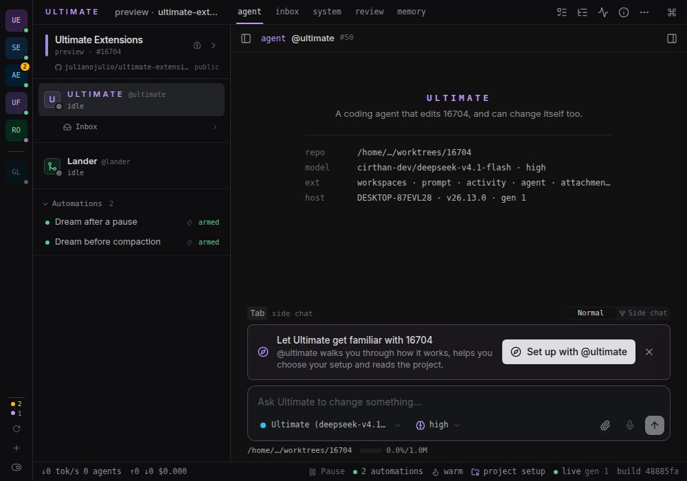
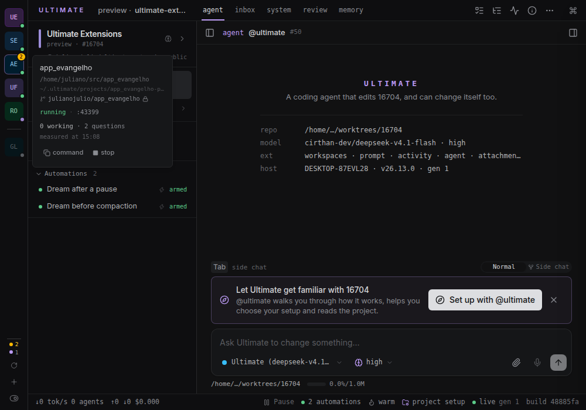
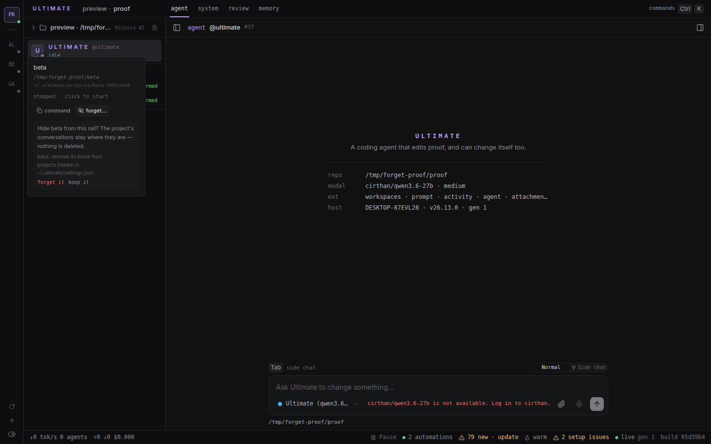
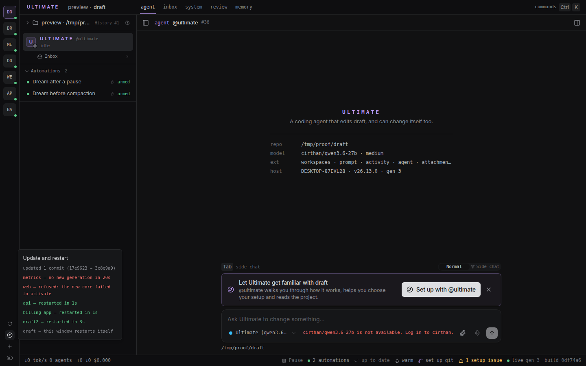

# projects — a rail of projects

A column on the left edge of the window, one tile per project: running hosts on top, stopped ones below,
each with a colour of its own, a presence dot and the number of unanswered questions. One click opens a
project or brings it up, and a button at the foot updates the clone and restarts every window of the
machine when there is something to do.



Ultimate ships its own `projects` extension, a switcher of running instances. This one has the same name
and takes the same `shell.rail` slot, so it **replaces** the built-in one: remove this folder from
`~/.ultimate/extensions/` (or run `sh install.sh` in a clone without it) to get the built-in rail back.

## How it works

One tile per project, drawn with its initials (`billing-app` → `BA`) in a tone taken from its folder name
alone — the same colour on every machine, copied from the app's own tile so a project has one colour in
both rails.

This window's project comes first, then the other running ones, a thin line, then the stopped ones. Inside
each group the tiles are a **stack**: the project whose rail was opened last is the first tile, so the
project you just left sits right below this one. The order belongs to the machine, not to a window
(`~/.ultimate/projects-shown.json`), so every window agrees on what came before.

The dot in the corner is the state: grey stopped, green up and idle, pulsing while the last reading saw it
working, hollow when the host does not answer. The number is the count of questions without an answer
(`9+` from ten up).

Hovering or focusing a tile opens its panel with what the tile does not fit: the repo (`owner/repo` from its
`origin`, with a lock when it is private), the port, the state in words, the working conversations and open
questions with the time of the reading, the command to copy and the buttons.



The foot of the rail sums the tiles from the numbers the wave already brought — `1 for you · 2 working`,
questions first, and no line at all when both are zero.

## Using it

- **Switch project** — click a running tile; ⌘/Ctrl+click opens a new tab. The target builds its web bundle
  first, so the tile says `opening…` until the next page paints.
- **Bring a stopped project up** — click its tile. If it does not come up, the tile gains a red ring and the
  panel says why.
- **Create a project** — `+` at the bottom of the rail, then the folder's path, absolute or from `~`.
- **Refresh** — `⟳` reads every project again now, and each panel says when its numbers were read.
- **Forget a project** — `forget…` in the panel of a stopped project: the tile leaves the rail, and the home,
  with its conversations, stays where it was.
- **Update and restart** — the button beside `⟳`, there only when there is something to do: it updates the
  clone once through Ultimate's own update, then restarts, one at a time, every host running old code, this
  window last. It never pushes and never resolves a conflict; a diverged clone restarts anyway and waits for
  a merge, which shows as amber, never red.
- **Splash on or off** — the switch at the bottom of the rail.

## Configuration

Three keys of `~/.ultimate/settings.json` are this extension's; every other key of the file stays as it is.

**The splash switch.** The switch flips one entry, and a different set of extensions means a new web bundle,
so every open window reloads:

```json
{ "extensions": { "disable": ["splash"] } }
```

**Hidden projects.** `forget…` adds the project's **home** — not its name; two folders can share a name — to
this list, and the tile is gone on the next reading. Nothing is deleted: remove the home and save, or ask for
the folder again with `+`, and the tile comes back.

```json
{ "projects": { "hidden": ["~/.ultimate/projects/old-app-1a2b3c4d"] } }
```



**The nightly update.** Once a night, on a machine where no conversation is working, the update button runs by
itself. `at` is a local `HH:MM`, and **absent is off**:

```json
{ "projects": { "update": { "at": "03:00" } } }
```

A value that is not a time is ignored, with a notice that names it. The host that takes the night asks every
host that is up whether anything is working; one working conversation and it steps aside, trying once more 45
minutes later and then waiting for the next night. It never runs twice in a local day, and a machine asleep at
`at` catches up the next time a host is up. In the morning one quiet line at the foot of the rail says what
moved, what restarted, what failed and what waited for a merge; the ✕ puts it away for the day.



## Actions

For agents and automation. The last five are **user only**: an agent calling them is refused, so nothing
restarts every window, stops a host or hides a project behind the screen.

| Action | What it does |
| --- | --- |
| `list` | The projects with state, port and command, in the order the rail draws them; `{ measure: false }` skips the other hosts. |
| `shown` | Stamps this project in the order file. The rail calls it once per page load. |
| `measure` | `{ name }`: that project measured now, with the time of the answer. |
| `state` | This host only: working conversations, open questions, its build and generation. |
| `seen` | The line of the last night was read, so the rail stops drawing it. |
| `start` | `{ name }`: brings that host up and returns when it answers. |
| `stop` **user only** | `{ name, confirm? }`: takes that host down; asks first when this extension did not start it. |
| `create` **user only** | `{ path }`: brings up the host of a new folder and returns the new project. |
| `forget` **user only** | `{ name }`: hides that project from the rail by adding its home to `projects.hidden`. Refused for this window and for a host that is up. |
| `splash` **user only** | `{ enabled }`: turns the splash animation on or off. |
| `update` **user only** | Updates the clone once and restarts the hosts the clone moved past, one at a time. Returns the pull and one result per host. |

## Limits

- It does not poll: a reading happens when the rail is opened, entered or focused, on `⟳`, and after every
  action that changes the machine.
- It does not delete anything and it does not stop what it did not start: a forgotten project is hidden, and a
  host born in a terminal stops only after a confirmation naming its port and pid.
- It does not run `git` or `pnpm`: the button asks Ultimate's own update, which refuses a dirty or switched
  clone instead of resolving it. The only programs it runs are the two that name a project's repo,
  `git remote get-url origin` and `gh repo view`, read-only and in the background.
- It does not draw a second rail: another extension in `shell.rail` wins and this one draws nothing, so a
  window never shows two.
