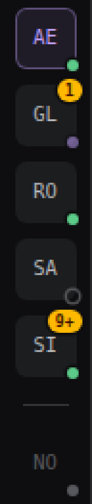

The rail of this machine's projects: a 48px column on the left edge of the window with one tile per
project — running hosts on top, stopped ones below —, where the whole block is the click. Tap a running
project and it opens in this tab; tap a stopped one and the host comes up; and the tile panel says what
the tile cannot fit: the port, the state in words, how many conversations of that project are working
and how many questions wait for an answer, measured at the moment the panel opens.

Every tile carries the app's **presence dot**: grey stopped, green idle, pulsing while it works, and
the number in amber when a question has no answer. At the bottom of the rail sit the ⟳ (measure
again), the `+` (create a project) and the switch of the **splash animation** — which writes only the
`splash` entry of this machine's settings.


**Machine extension**: it lives in `~/.ultimate/extensions/projetos/` — a symlink to `projetos/` in the
`ultimate-extensions` repository —, applies to every project on this machine and belongs to none of
them. It uses the `shell.rail` slot, a full-height column beside the title bar and every surface
(agent, system, review, memory); inside a frame Ultimate does not draw the rail and the extension does
not appear.

## The rail

```
┌──┐
│AE●│  ← this window: text-brand, green dot (idle), and the click only opens the panel
│GL●│  ← running and working: the dot pulses (brand); the ① in the top corner is a question
│RO●│  ← running and idle: green dot
│SA○│  ← running and not answering: hollow dot, no pulse and no amber
│──│  ← a thin line separates the running ones from the stopped ones
│NO●│  ← stopped, dimmer: grey dot, and the click brings the host up
│  │
│⟳ │  ← measure again (the title says the time of the last read)
│+ │  ← create a project
│◑ │  ← the splash animation: switch to the right = on (the title says the rest)
└──┘
```

- **The initials, not the name.** Two letters per project: `app_evangelho` → `AE`, `robsoncosta` → `RO`,
  `gta2xlwifi-lineage` → `GL` (two words give the first letter of each; one word gives its first two
  letters). Two projects can coincide in their initials — the panel gives the full name and path, and
  so does the tile's `title`.
- **The whole block is the click target**, and **the port does not appear on the tile**: it is the
  address of the link (`http://127.0.0.1:<port>`), not on-screen information. `:port` is read in the
  panel, where it is diagnostics.
- **Order**: this window's project opens the column; the other running ones come by name; the thin
  line; the stopped ones by name. The same order on every open, so that a tile does not jump around.
- **Running, and it is not this window** → the tile is an `<a href>`: one click opens that project **in
  this tab** (it is a project switcher, not a way to peek at them; ⌘/Ctrl+click opens a new tab, like
  any link).
- **Stopped** → the tile is a `<button>`: one click brings the host up (the same spawn as `iniciar`),
  and the tile shows a spinner while it comes up. Did it not come up? The tile gains a red ring with
  the error in the `title`, and the panel says the error — the last `Error:` line of the process log.
- **This window** → `text-brand`, with the background tinted brand and no switch action: one click
  opens the panel. What serves the screen you are clicking in is not switched for itself.
- **State in words, never colour alone**: the tile is too small for the word, so it is in the panel
  (`running` / `stopped`, and `stopping` while `stop` works), in the column's order — running on top,
  stopped below — and in each tile's `title`/`aria-label`, which give the whole sentence. The dot's
  colour is reinforcement.

## The state on the tile



The 6px dot in the corner is the **app's own presence scheme** (the conversations' `AgentMark`):
`size-1.5 rounded-full`, with the rail-coloured ring over it, and `data-presence` on the element. The
classes are copied from `extensions/conversations/marks.tsx` — this extension does not import from
there —, so the rail and the sidebar speak the same visual language.

| What you see | When |
| --- | --- |
| **grey** dot (`muted-foreground/60`) | the project is stopped; the tile is also dimmer |
| **green** dot (`success`) | running and idle: `0 working` measured |
| **pulsing** dot (`animate-pulse-dot bg-brand`) | running and with a conversation working now |
| **hollow** dot (only the ring) | running and **not answering** within 3 s: the tile says `unavailable`, with the reason |
| **amber number** in the top corner | there is a question without an answer; `1`..`9`, and `9+` from ten up. At zero it does not appear |

- **The number does not cover the initials.** It sits in the top-right corner, in the gap between the
  tiles — which are spaced 8px apart for that reason —, with the rail-coloured ring separating it from
  the background. A `9+` above ten is the limit: the exact number of 42 questions does not change the
  decision of whoever looks at the rail, and too wide a number would hide the project's name.
- **Not answering is not idle.** A running host that did not answer within the deadline stays without
  pulse and without amber, with the hollow dot — the silence of a stuck host cannot be read as calm.
- **Zero is a measurement.** `0 working` is an answer, and it is what turns the dot green. What has not
  been measured yet (the wave has not come back) is not zero either: the dot stays hollow and the
  `title` says `not measured yet`.
- **The tile's `title` and `aria-label` give the whole sentence**, with the time of the measurement:
  `gta2xlwifi-lineage — running · 2 working · 1 unanswered question · measured at 21:53 — open it in this tab`. An
  indicator that ages is acceptable; one that lies is not — which is why it carries when it is from.
- **When it measures:** on mounting the rail, on entering the rail with the pointer (**at most once
  every 15 s**), on `⟳`, and after every action that changes the machine (`iniciar`, `parar`,
  `criar`). The panel keeps measuring when it opens, and its measurement holds for that tile — it wins
  over the wave's.
- **There is no timer.** The read is the full `listar` action (each running host's `estado`, in
  parallel, with the 3 s deadline that already existed): a snapshot, with a time, not a clock.

## The tile panel


It opens on **hover** and on **focus** (Tab up to the tile), and closes when the pointer or the focus
leaves, or with `Esc`. It is `position: fixed`: it is not clipped when the column scrolls, and it stays
a child of the tile in the DOM order, which is what lets the keyboard reach its buttons. Content, from
top to bottom:

| What | From where |
| --- | --- |
| the name and the path | `host.projects()` (the project home's `project.json`) |
| `running` / `stopped`, and `:port` | that project's lock, re-read on every read |
| `this window` | the project that serves this window |
| `1 working · 1 question` | the `medir` action, asked **when the panel opens**, with the time beside it |
| `command` | copies `ultimate <path>`, with single quotes when the path asks for them |
| `stop` | only on a running project that is not this window |

- **The measurement is of the instant the panel opens**, and the panel writes its time (`measured at
  21:53`). Closed, nobody measures anything: there is no poll, and the number never appears on the
  tile. The measurement the panel makes also holds for that tile's dot and number on the rail: while
  the panel is open, it wins over the wave's.
- **An invented zero is the worst possible error here**: a host that does not answer in 3 s shows
  **`unavailable` with the reason** (`no answer in 3s`, `HTTP 404`, …), never `0`. It is exactly the
  false zero that would make one ignore the stuck project.
- **A stopped project shows no measurement**: there is nobody to ask. The panel says `stopped · click
  to start` and offers the command to copy.
- **Stop** kills only the pid of that project's lock (see the rules below). A host **that this
  extension did not start** — born in a terminal, in a supervisor, by someone else — stops only after
  the panel asks, with the port and the pid in the text: `Stop the host on :4803 (pid 1234)? It was
  not started from here.` → `stop it` / `keep it`. The answer reaches the action as `confirm: true`;
  without it, the action returns `precisaConfirmar` and touches nothing.
- An action error appears in the panel itself, in one to three lines (the whole text in the `title`).

## The `+`: create a project


A path field and a button. The path accepts `~` (the home of whoever is using it) and has to be
**absolute**: empty, accidentally relative and `~other` are refused with a sentence, not with a guessed
folder. The server checks that the folder exists and is a directory (`No such folder: …`,
`Not a folder: …`) and then brings the host up as `iniciar` does: `ultimate <path>` on the first free
port from **4747**, detached (`detached`, no tty), **without a window** (`--no-open`), with health being
`GET /` on that port within **20 s** (not up in the deadline? the process is terminated and the dialog
shows the last error line of its log).

- **The tile appears** on its own when the host answers, and the dialog swaps the form for a card:
  `novo is running :4750`, with `Open it` (opens that window) and `Done` (stays here). Creating does
  not change window for you: **that project's first run, the onboarding and the trust decision for
  that folder happen in its own window** — this extension decides nothing for it.
- **A path that is already a project in the list is selected, not duplicated**: running, the card says
  `app_evangelho is running :4801` and `No second host was started for that folder.`; stopped, this
  extension brings that host up; and this window's own path says `is this window`. In none of those
  cases is a second host born for the same root.
- **Two folders with the same project name cannot be told apart here**, because the actions speak by
  name: a second `app` would make the first's tile answer for the second (and stop it in its place). So
  the `+` **refuses** the second outright, naming the project that already exists.
- **A new project does not register itself by hand**: the central home (`~/.ultimate/projects/<name>-<8
  hex of the path>`) is born with the host running in that folder, which is why `listar` already finds
  it on the next read. The extension computes that home to pass `ULTIMATE_HOME` to the process — it is
  the same calculation as `server/project.ts:projectHome`, and it is the only point in this extension
  that depends on a detail of Ultimate; if it changes there, what breaks is the new project's tile
  appearing (and the fix is to keep the two the same).

## The splash animation


Ultimate opens with the wordmark drawing itself over the window while the app loads. That is the
splash, and on switching projects it appears again. The last icon at the bottom of the rail turns it on
and off with one click:

- **switch to the right** = on; **to the left** = off. The `title` and the `aria-label` give both:
  `Splash on project switch: on — turn it off` / `Splash on project switch: off — turn it on`.
  Before the column's first read the state is not known, and the sentence says `unknown`.
- **One click is reversible**, so it asks nothing: it asks the `splash` action for the opposite of what
  the column read.
- **Where it writes**: `~/.ultimate/settings.json`, this machine's layer — the **only** place where
  this extension writes outside the home of a project it started itself. The file is read first and
  rewritten through a temporary beside it and a `rename`, with **every other key preserved**
  (`modelFamilies`, `lander`, whatever there is).
- **What it changes**: only the `splash` entry of `extensions.disable` — turning it off adds the name
  once, turning it on removes it. `extensions.enable` **is not touched** (`disable` wins over `enable`
  in the same layer, so turning it off works even with `splash` there), and the project's settings are
  never written.
- **The file is rewritten as normalised JSON** (two-space indentation, one line at the end): the
  formatting from before, and only it, is lost.
- **What it refuses, without writing anything**: invalid JSON, a file that is not an object, an
  `extensions` that is not an object, a `disable` that is not a list of names — the core would throw the
  whole file away, and the user would lose all the other keys. The error sentence (with the path and
  the reason, plus `Nothing was written`) appears in the button's `title`, which becomes a red `!`; the
  file stays exactly as it was. A missing file is not an error: turning it off creates the file,
  turning it on creates nothing.
- **The limit, written down**: a `<project>/.ultimate/settings.json` can turn the splash off or on **on
  top** of this, because the project's layer wins over the user's. This button speaks about this
  machine's layer: with a project saying the opposite, it changes what is written in your file and the
  effect in that project remains the project's.
- **The extension hot-loads**: the state the button shows comes from the column's read (`listar` returns
  `splash`), never from a module variable — and `splash.enabled` in the host's extension list changes
  **without a restart**.

## The four rules of starting, stopping and creating

All four are mandatory, and each one was born from a way of lying:

1. **The guard is the live pid, never the file.** An `ultimate.lock` whose pid no longer exists is a
   stopped project — the tile says `stopped` and the click brings it up. A live pid's lock is "already
   running on :N" and the start click does nothing. The lock is re-read from disk on every action: the
   extension reloads between one and the other, and a list in memory would age.
2. **The host is born detached.** `spawn` with `detached` (the system's `setsid`), no tty, with the
   output in a file — a child of the host that started it would die on its restart.
3. **The port is the first free one from 4747, and the answer is the health check.** It starts on
   `--port <N>` (the first one where a listener can be opened on loopback), and the link is returned
   only when `GET /` on that port answers: **20 s** deadline. Not up in the deadline, the process that
   was started is terminated and the error goes to the panel — its log's last `Error:` line —, never a
   lying green.
4. **Stopping kills only the pid of that project's lock** (`SIGTERM`, and `SIGKILL` after 8 s) and
   checks that the lock is gone. No `pkill`, no killing by port, no process group — and a host this
   extension did not start asks for confirmation, as the panel shows above.

## The phone, and the sidebar on the desktop

- **On the phone there is no rail**: a 48px column beside a 390px conversation is a theft of space. The
  sidebar — which on the phone is a drawer — keeps **the compact list from before**: the dot, the name,
  the state in words, `:port` (link to the same tab) with `1 working · 1 question` beside it, the
  command to copy when the project is stopped, and the start and stop button, visible on touch
  (`pointer-coarse`), because there is no hover on a touch to reveal it.
- **On the desktop and on the tablet the sidebar's Projects section ceases to exist**: the rail is the
  only project switcher. With that the sidebar starts again at @ultimate, without the section above it.
- The split is by the SDK's `useViewport()`: `phone` for the list, `desktop` and `tablet` for the rail.

## Where the data comes from, and when it measures

| What | From where | When |
| --- | --- | --- |
| the projects, the root, the pid and the URL | `host.projects()`: the homes of `~/.ultimate/projects`, with `running` only for those with a **live pid** in the lock | on opening the window, after every action, and on the refresh button |
| the conversations working **in this** project | `host.conversations()`, the `busy` of this host's task graph | on the rail's wave, and when this tile's panel opens |
| the questions without an answer **of this** project | the `messages` service (`openQuestions`), the same count as the questions panel | on the rail's wave, and when this tile's panel opens |
| the same, **in another** project | `POST <url of the other host>/api/extensions/projetos/actions/estado`, on loopback, with the target's `Origin` — the same path `lib/remote.ts` uses to talk to another instance | on the rail's wave, and when that tile's panel opens |

Neither the `busy` nor another project's questions are anywhere on disk: the `conversations.json` each
host publishes keeps neither the task graph nor the question box (on purpose). So the question goes to
that project's own host, which answers about itself (`estado`) and **does not relay the question to
anyone else**.

The rail opens with `listar({ medir: false })`: the cheap read, without a trip to another host, which
only says who is up (it is what draws the tiles). The **wave** is the full `listar()`, and it is what
lights the dot and the number: it goes out on mounting the rail, on entering the rail with the pointer
(at most once every 15 s), on `⟳` and after every action that changes the machine. `listar()` with no
argument keeps measuring everyone (that is what the phone list shows, and what any caller from outside
receives), now with `splash` among the fields.

## What the extension writes on disk

In the home of a project that it started itself:

- `<project home>/projetos-started.json` — `{ pid, port, at }`: the pid this extension started. It is
  what lets `stop` know that host is its own, including after the extension itself reloads. A pid that
  does not match the lock's is read as "it was not me" and the panel asks. The file is deleted when the
  host stops.
- `<project home>/projetos-start.log` — the output of the process that was started (the supervisor
  writes the rest in `supervisor.log`); the error line in the panel comes from it.

And, for a **new** project, a system temporary directory (`ultimate-projetos-…` in the temporary
directory) with the first start's log, deleted as soon as the action finishes — because a new project
has no home yet. If the process dies before writing `project.json` (a port taken in the middle, a broken
`.ultimate/`, an interrupted reset), the extension **deletes the home it created**, and `listar` also
ignores a home without `project.json`: a dead start never becomes a tile without a path.

And **one** file outside those homes: this machine's `~/.ultimate/settings.json`, written by the splash
switch (the section above). It is the only one, and it is rewritten whole as normalised JSON — two-space
indentation and one line at the end, so the formatting from before is lost, but no key is lost.
`<project>/.ultimate/settings.json` is **never** touched.

**The two known limits, named:**

- Between the `spawn` and the writing of `projetos-started.json` there is a window of milliseconds. If
  the extension restarts there, the process it started stays alive and unregistered — and the worst
  case is **one extra confirmation click**, not a lost process.
- For a new project the record is written only **after** the host answers (before that there is no home
  to write to), so the same window holds for the whole first start, which lasts up to 20 s. The cost is
  still one extra confirmation click.

Nothing in `content/`, nothing in any project, and from the user's home only that settings file: nothing
is ever written in the user's `~/.ultimate` outside the homes of the projects this extension started —
and of the machine's `settings.json`, only the `splash` entry of `extensions.disable`.

## No poll

Opening the window reads once; switching the conversation shown is another read (the SDK indexes an
action's read by the conversation it is made in); the presence **wave** goes out on mount, on entering
the rail with the pointer (at most once every 15 s), on the refresh button (the bottom of the rail's
`⟳`, whose `title` says the time of the last read) and after every action that changes the machine.
There is no periodic timer, and no event subscription from another host: **an indicator that ages is
acceptable; one that lies is not** — and that is why each tile says, in the `title`, when the
measurement it shows is from.

## The actions

- `listar` — `{}` (or no argument): this machine's projects with state, port and command, measuring
  every running host. `{ medir: false }`: the same list **without** measurement and without a trip to
  another host — it is the rail's read.
- `medir` — `{ name }`. What was measured in that project now: `{ working, perguntasAbertas, motivo?, at }`.
  It is what the tile panel asks for when it opens.
- `estado` — no arguments. Only this host: `{ working, perguntasAbertas, at }`. It is what another host
  asks; it never leaves here to ask anyone else.
- `iniciar` — `{ name }`. Brings that project's host up and only returns when the port answers; returns
  the new line. A project that already runs comes back as it is.
- `criar` — `{ caminho }`. Expands `~`, checks the folder and brings its host up; returns
  `{ criado, projeto }`. A project that is already that folder is selected (or started, if it was
  stopped), never duplicated.
- `parar` — `{ name, confirm? }`. Brings that project's host down and checks that the lock is gone;
  returns `{ parado: true, projeto }`, or `{ parado: false, precisaConfirmar: true, pid, url }` when the
  host was not started by this extension and the `confirm: true` is still missing.
- `splash` — `{ enabled: boolean }`. Turns the splash animation on or off in this machine's settings and
  returns `{ splash }`; `listar` also returns `splash`, which is where the bottom button reads the state
  from. It refuses, without writing, the file the core would refuse whole.

`estado`, `iniciar` and `parar` continue exactly as they were: they are the API another host on this
machine calls, and the rail has only started using `listar` with `medir: false`, the `medir` action and
the `splash` action.

## What remains out

- **It does not measure the host at every instant.** The dot and the number are from one read, with a
  time: they age until the next wave, and it is the `title` that says when they are from. There is no
  timer, and nothing blinks on its own beyond the "it is working" pulse.
- **It does not show the port number on the rail**, on purpose: it is an address, not information. It
  is in the panel, for diagnostics.
- **It has no rail on the phone**, and does not switch projects through it there: on the phone, the
  sidebar's drawer is the switcher.
- **It decides nothing for a new project**: creating brings the host up and shows the tile; onboarding,
  trust and that folder's first run happen in its own window. And creating does not change window by
  itself.
- **It does not act on a host the extension did not start** without asking — and never kills by port,
  by name or by group.
- **It schedules nothing.** Starting, stopping and creating are clicks; there is no schedule, trigger or
  supervisor of its own.
- **It does not poll or follow in real time**: to see again, the pointer on the rail (every 15 s), the
  tile panel or `⟳`.
- **It does not hide, move or delete a project.** The list is the one Ultimate has; a home outside
  `~/.ultimate/projects` (a preview, a scratch server) does not appear in it — and such a project can be
  created again with the `+` as if it were new, because to this extension it is.
- **It does not tell two projects with the same folder name apart.** The actions speak by project name:
  with two `app` on the machine, the first (by home) is the one that answers `iniciar`, `parar` and
  `medir` — including when the tile and the panel you click are the second's. The `+` refuses to create
  the second, and each tile's panel shows the whole path, so that one knows which is which.
- **It does not reach another machine**: only what runs on this one, on loopback.
- **It does not clean an orphan lock**: if a host only stopped with `SIGKILL`, its lock stays (with a
  dead pid) and the tile says stopped; the one that replaces it is `ultimate` itself, on starting again.
- **It does not switch projects in a frame**: Ultimate does not draw the `shell.rail` slot inside a
  frame, and the extension respects that.
- **It is not an extension switch**: the bottom button touches only the splash, and only in this
  machine's layer. What turns extensions on and off in general is Ultimate's setup panel.

## Languages

The interface speaks **English**, like the rest of Ultimate (`New project`, `running`, `stopped`,
`0 questions`, `stop it`, `Splash on project switch: on — turn it off`), because the rail lives beside
`Conversations` and `Automations`. Both the interface and this README are in English.

## Tests

```sh
cd ~/src/ultimate-extensions/projetos
node --test projetos.test.ts
```

26 pure tests, with fixtures: the words of the state; the link's port (and the URL without a port); the
count and the question counter, including what was not measured and the **zero that is a measurement**;
the tile's presence dot (working, idle, stopped and not answering) and the corner number (1..9, `9+`,
nothing at zero); the tile's sentence, with the time of the measurement; the wave that separates running
projects from stopped ones; the `argv` with which a host is started; the choice of the first free port
(and the exhausted range); the stop decision — including the dead-pid lock and this window's project,
which has nothing to stop; the tile's initials and the tile that carries no port; the rail's two groups
(this window's first, and a project with only a measurement counting as stopped); the dialog's expansion
and refusal of a path; the home a new project will occupy; and the splash — turning it on and off while
preserving the other keys, without duplicating the entry, and refusing what the core would refuse whole.
No test reads the machine, opens a process or makes a request.

Each extension's `node_modules` is a **symlink to `~/src/ultimate/node_modules`**, created by the
repository's `install.sh` (this machine's extensions trick). The reading of the machine, the trip to the
other host, `splash.enabled` changing without a restart, the real starting and stopping and creating are
proven live — with an isolated instance (temporary `ULTIMATE_USER_HOME` and `ULTIMATE_HOME`, the
extension linked by symlink to the checkout you work in), a real project created with the `+` and fake
hosts for the dot's four states: that is how the five images above were made. The pulse does not appear
in a PNG — the images show the working dot stopped in one frame.
