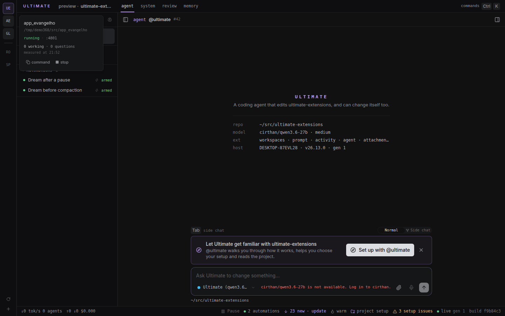
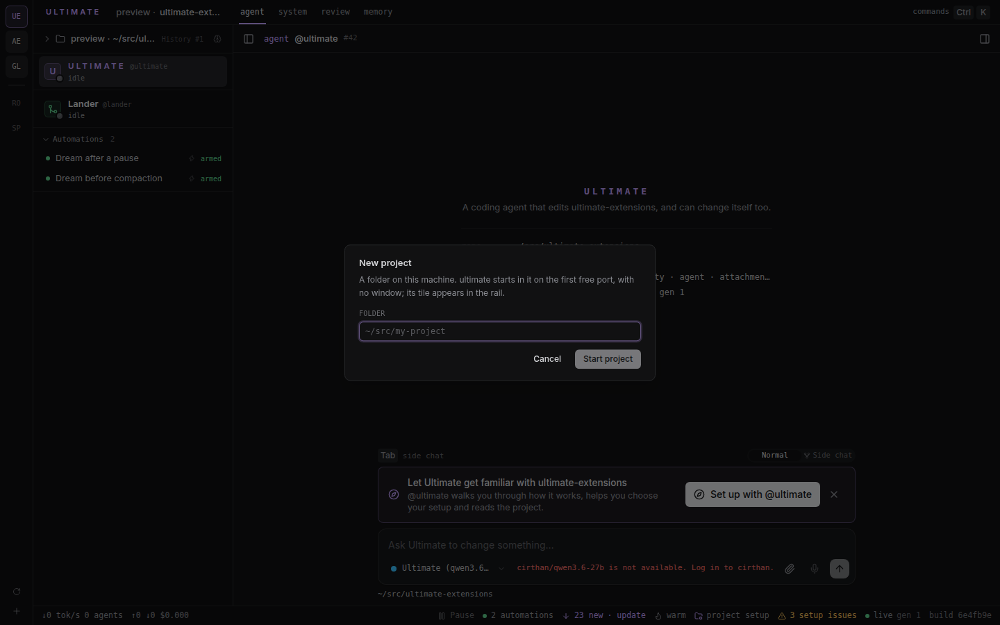

O rail dos projetos desta máquina: uma coluna de 48px na borda esquerda da janela com um tile por
projeto — os hosts de pé em cima, os parados embaixo —, onde o bloco inteiro é o clique. Tocar num
projeto de pé abre aquele projeto nesta aba; tocar num parado sobe o host; e o painel do tile diz o
que o tile não cabe: a porta, o estado escrito, quantas conversas daquele projeto estão trabalhando e
quantas perguntas esperam resposta, medido na hora em que o painel abre.


**Extensão de máquina**: mora em `~/.ultimate/extensions/projetos/` — um symlink para `projetos/` no
repositório `ultimate-extensions` —, vale em todos os projetos desta máquina e não pertence a nenhum
deles. Ela usa o slot `shell.rail`, que é uma coluna de altura inteira ao lado da barra de título e de
todas as superfícies (agent, system, review, memory); dentro de um frame, o Ultimate não desenha o
rail e a extensão não aparece.

## O rail

```
┌──┐
│UE│  ← esta janela: text-brand, e o clique só abre o painel
│AE│  ← de pé: o bloco inteiro é um link para http://127.0.0.1:<porta>
│GL│
│──│  ← uma linha fina separa os de pé dos parados
│RO│
│SP│  ← parados, mais apagados: o clique sobe o host
│  │
│⟳ │  ← medir de novo (o title diz a hora da última leitura)
│+ │  ← criar um projeto
└──┘
```

- **As iniciais, não o nome.** Duas letras por projeto: `app_evangelho` → `AE`, `robsoncosta` → `RO`,
  `gta2xlwifi-lineage` → `GL` (duas palavras dão a primeira letra de cada uma; uma só dá as duas
  primeiras letras). Dois projetos podem coincidir nas iniciais — o painel diz nome e caminho inteiros,
  e o `title` do tile também.
- **O bloco inteiro é o alvo do clique**, e **a porta não aparece no tile**: ela é o endereço do link
  (`http://127.0.0.1:<porta>`), não informação da tela. `:porta` se lê no painel, onde é diagnóstico.
- **Ordem**: o projeto desta janela abre a coluna; os outros de pé vêm por nome; a linha fina; os
  parados por nome. A mesma ordem em cada abertura, para um tile não pular de lugar.
- **De pé e não é esta janela** → o tile é um `<a href>`: um clique abre aquele projeto **nesta aba**
  (é um trocador de projeto, não um espiador; ⌘/Ctrl+clique abre em aba nova, como qualquer link).
- **Parado** → o tile é um `<button>`: um clique sobe o host (o mesmo spawn do `iniciar`), e o tile
  mostra um giro enquanto ele sobe. Não subiu? O tile ganha um anel vermelho com o erro no `title`, e
  o painel diz o erro — a última linha `Error:` do log do processo.
- **Esta janela** → `text-brand`, com o fundo tingido de brand e nenhuma ação de troca: um clique abre
  o painel. Quem serve a tela em que se clica não se troca por ela mesma.
- **Estado escrito, nunca só na cor**: o tile é pequeno demais para a palavra, então ela está no painel
  (`running` / `stopped`, e `stopping` enquanto o `stop` trabalha) e na ordem da coluna — os de pé em
  cima, os parados embaixo. A cor é reforço.

## O painel do tile



Abre no **hover** e no **foco** (Tab até o tile), e fecha quando o ponteiro ou o foco sai, ou com
`Esc`. Ele é `position: fixed`: não é recortado quando a coluna rola, e continua filho do tile na
ordem do DOM, que é o que deixa o teclado chegar aos botões dele. Conteúdo, de cima para baixo:

| O que | De onde |
| --- | --- |
| o nome e o caminho | `host.projects()` (o `project.json` do home do projeto) |
| `running` / `stopped`, e `:porta` | o lock daquele projeto, relido a cada leitura |
| `this window` | o projeto que serve esta janela |
| `1 working · 1 question` | a ação `medir`, perguntada **quando o painel abre**, com a hora ao lado |
| `command` | copia `ultimate <caminho>`, com aspas simples quando o caminho pede |
| `stop` | só num projeto de pé que não é esta janela |

- **A medida é do instante em que o painel abre**, e o painel escreve a hora dela (`measured at
  21:53`). Fechado, ninguém mede nada: não há poll, e o número nunca aparece no tile.
- **Zero inventado é o pior erro possível aqui**: um host que não responde em 3 s mostra
  **`unavailable` com o motivo** (`no answer in 3s`, `HTTP 404`, …), nunca `0`. É justamente o zero
  falso que faria ignorar o projeto travado.
- **Um projeto parado não mostra medida**: não há a quem perguntar. O painel diz `stopped · click to
  start` e oferece o comando a copiar.
- **Parar** mata só o pid do lock daquele projeto (ver as regras abaixo). Um host **que esta extensão
  não subiu** — nascido num terminal, num supervisor, por outra pessoa — só para depois de o painel
  perguntar, com a porta e o pid no texto: `Stop the host on :4803 (pid 1234)? It was not started from
  here.` → `stop it` / `keep it`. A resposta chega à ação como `confirm: true`; sem ela, a ação devolve
  `precisaConfirmar` e não toca em nada.
- Um erro de ação aparece no próprio painel, em uma a três linhas (o texto inteiro no `title`).

## O `+`: criar um projeto



Um campo de caminho e um botão. O caminho aceita `~` (o home de quem usa) e tem de ser **absoluto**:
vazio, relativo ao acaso e `~outro` são recusados com uma frase, não com uma pasta adivinhada. O
servidor confere que a pasta existe e é um diretório (`No such folder: …`, `Not a folder: …`) e então
sobe o host como o `iniciar` sobe: `ultimate <caminho>` na primeira porta livre a partir de **4747**,
destacado (`detached`, sem tty), **sem janela** (`--no-open`), com a saúde sendo `GET /` naquela porta
em **20 s** (não subiu no prazo? o processo é encerrado e o diálogo mostra a última linha de erro do
log dele).

- **O tile aparece** sozinho quando o host responde, e o diálogo troca o formulário por um cartão:
  `novo is running :4750`, com `Open it` (abre aquela janela) e `Done` (fica aqui). Criar não troca de
  janela por você: **a primeira execução daquele projeto, o onboarding e a decisão de confiança
  daquela pasta acontecem na janela dele** — esta extensão não decide nada por ele.
- **Um caminho que já é um projeto da lista é selecionado, não duplicado**: de pé, o cartão diz
  `app_evangelho is running :4801` e `No second host was started for that folder.`; parado, esta
  extensão sobe aquele host; e o caminho desta própria janela diz `is this window`. Em nenhum desses
  casos nasce um segundo host para a mesma raiz.
- **Um projeto novo não se registra à mão**: o home central (`~/.ultimate/projects/<nome>-<8 hex do
  caminho>`) nasce com o host que roda naquela pasta, e é por isso que `listar` já o encontra na
  leitura seguinte. A extensão calcula esse home para passar `ULTIMATE_HOME` ao processo — é o mesmo
  cálculo de `server/project.ts:projectHome`, e é o único ponto desta extensão que depende de um
  detalhe do Ultimate; se ele mudar lá, o que quebra é o tile do projeto novo aparecer (e o conserto é
  manter os dois iguais).

## As quatro regras de subir, parar e criar

São todas obrigatórias, e cada uma nasceu de um jeito de mentir:

1. **A guarda é o pid vivo, nunca o arquivo.** Um `ultimate.lock` cujo pid não existe mais é um projeto
   parado — o tile diz `stopped` e o clique sobe. Um lock de pid vivo é «já roda em :N» e o clique de
   subir não faz nada. O lock é relido do disco a cada ação: a extensão recarrega entre uma e outra, e
   uma lista em memória envelheceria.
2. **O host nasce destacado.** `spawn` com `detached` (o `setsid` do sistema), sem tty, com a saída num
   arquivo — um filho do host que o subiu morreria no reinício deste.
3. **A porta é a primeira livre a partir de 4747, e a resposta é a saúde.** Sobe-se em `--port <N>` (o
   primeiro em que se consegue abrir um listener em loopback), e só se devolve o link quando `GET /`
   naquela porta responde: **20 s** de prazo. Não subiu no prazo, o processo que se subiu é encerrado e
   o erro vai para o painel — a última linha `Error:` do log dele —, nunca um verde mentiroso.
4. **Parar mata só o pid do lock daquele projeto** (`SIGTERM`, e `SIGKILL` depois de 8 s) e confere que
   o lock sumiu. Nada de `pkill`, nada de matar por porta, nada de grupo de processos — e um host que
   esta extensão não subiu pede confirmação, como o painel mostra acima.

## O celular, e a sidebar no desktop

- **No celular não há rail**: uma coluna de 48px ao lado de uma conversa de 390px é roubo de espaço. A
  sidebar — que no celular é uma gaveta — continua com a **lista compacta de antes**: o ponto, o nome,
  o estado escrito, `:porta` (link para a mesma aba) com `1 working · 1 question` ao lado, o comando a
  copiar quando o projeto está parado, e o botão de subir e parar, visível ao toque
  (`pointer-coarse`), porque num toque não há hover para revelá-lo.
- **No desktop e no tablet a seção Projects da sidebar deixa de existir**: quem troca de projeto é o
  rail, um só. Com isso a sidebar volta a começar em @ultimate, sem a seção acima.
- A divisão é pelo `useViewport()` do SDK: `phone` para a lista, `desktop` e `tablet` para o rail.

## De onde vêm os dados, e quando se mede

| O que | De onde | Quando |
| --- | --- | --- |
| os projetos, a raiz, o pid e a URL | `host.projects()`: os homes de `~/.ultimate/projects`, com `running` só para quem tem **pid vivo** no lock | ao abrir a janela, depois de cada ação, e no botão de atualizar |
| as conversas trabalhando **deste** projeto | `host.conversations()`, o `busy` do grafo de tarefas deste host | quando o painel deste tile abre |
| as perguntas sem resposta **deste** projeto | o serviço `messages` (`openQuestions`), a mesma conta do painel de perguntas | quando o painel deste tile abre |
| o mesmo, **em outro** projeto | `POST <url do outro host>/api/extensions/projetos/actions/estado`, em loopback, com a `Origin` do alvo — o mesmo caminho que `lib/remote.ts` usa para falar com outra instância | quando o painel daquele tile abre |

Nem o `busy` nem as perguntas de outro projeto estão em lugar nenhum do disco: o `conversations.json`
que cada host publica não guarda o grafo de tarefas nem a caixa de perguntas (de propósito). Então a
pergunta vai ao próprio host daquele projeto, que responde de si mesmo (`estado`) e **não repassa a
pergunta a mais ninguém**.

O rail chama `listar({ medir: false })`: a leitura barata, sem viagem a outro host, porque um tile não
mostra número. `listar()` sem argumento continua medindo todo mundo (é o que a lista do celular mostra,
e o que qualquer chamador de fora recebe).

## O que a extensão escreve no disco

Só no home de um projeto que ela mesma subiu:

- `<home do projeto>/projetos-started.json` — `{ pid, port, at }`: o pid que esta extensão subiu. É o
  que deixa o `stop` saber que aquele host é dela, inclusive depois de a própria extensão recarregar.
  Um pid que não bate com o do lock é lido como «não fui eu» e o painel pergunta. O arquivo é apagado
  quando o host para.
- `<home do projeto>/projetos-start.log` — a saída do processo que se subiu (o supervisor escreve o
  resto em `supervisor.log`); é dele que sai a linha de erro no painel.

E, para um projeto **novo**, um diretório temporário do sistema (`ultimate-projetos-…` no diretório de
temporários) com o log da primeira subida, apagado assim que a ação termina — porque um projeto novo
ainda não tem home, e um home criado pela extensão ficaria órfão na lista se a subida falhasse.

**Os dois limites conhecidos, nomeados:**

- Entre o `spawn` e a escrita do `projetos-started.json` há uma janela de milissegundos. Se a extensão
  reiniciar ali, o processo que ela subiu fica vivo e sem registo — e o pior caso é **um clique de
  confirmação a mais**, não um processo perdido.
- Para um projeto novo o registo só é escrito **depois** que o host responde (antes disso não há home
  para escrever), então a mesma janela vale para toda a primeira subida, que dura até 20 s. O custo
  continua sendo um clique de confirmação a mais.

Nada em `content/`, nada em settings, nada em projeto nenhum. Nunca se escreve no `~/.ultimate` de
quem usa fora dos homes dos projetos que esta extensão subiu.

## Sem poll

Abrir a janela lê uma vez; o botão de atualizar (o `⟳` do pé do rail, cujo `title` diz a hora da última
leitura) é a outra leitura, e as ações `iniciar`, `parar` e `criar` releem ao terminar, porque mudaram
a máquina. Não há timer, nem assinatura de evento de outro host: **um contador que envelhece é
aceitável; um contador que mente não é**.

## As ações

- `listar` — `{}` (ou sem argumento): os projetos da máquina com estado, porta e comando, medindo cada
  host de pé. `{ medir: false }`: a mesma lista **sem** medida e sem viagem a outro host — é a leitura
  do rail.
- `medir` — `{ name }`. O que se mediu naquele projeto agora: `{ working, perguntasAbertas, motivo?, at }`.
  É o que o painel do tile pede quando abre.
- `estado` — sem argumentos. Só este host: `{ working, perguntasAbertas, at }`. É o que outro host
  pergunta; nunca sai daqui para perguntar a mais ninguém.
- `iniciar` — `{ name }`. Sobe o host daquele projeto e só volta quando a porta responde; devolve a
  linha nova. Um projeto que já roda volta como está.
- `criar` — `{ caminho }`. Expande `~`, confere a pasta e sobe o host dela; devolve
  `{ criado, projeto }`. Um projeto que já é aquela pasta é selecionado (ou subido, se estava parado),
  nunca duplicado.
- `parar` — `{ name, confirm? }`. Deita o host daquele projeto e confere que o lock sumiu; devolve
  `{ parado: true, projeto }`, ou `{ parado: false, precisaConfirmar: true, pid, url }` quando o host
  não foi esta extensão que subiu e ainda falta o `confirm: true`.

`estado`, `iniciar` e `parar` continuam exatamente como eram: são a API que outro host desta máquina
chama, e o rail apenas passou a usar `listar` com `medir: false` e a ação nova `medir`.

## O que continua fora

- **Não mede nada sem o painel abrir.** O número do tile não existe; a medida é do instante em que se
  olha. Fechar o painel não deixa número velho na tela.
- **Não mostra o número da porta no rail**, de propósito: ele é endereço, não informação. Está no
  painel, para diagnóstico.
- **Não tem rail no celular**, e não troca de projeto por ele lá: no celular, a gaveta da sidebar é o
  trocador.
- **Não decide nada por um projeto novo**: criar sobe o host e mostra o tile; onboarding, confiança e a
  primeira execução daquela pasta acontecem na janela dele. E criar não troca de janela sozinho.
- **Não age sobre host que a extensão não subiu** sem perguntar — e nunca mata por porta, por nome nem
  por grupo.
- **Não agenda nada.** Subir, parar e criar são cliques; não há horário, gatilho nem supervisor próprio.
- **Não faz poll nem acompanha em tempo real**: para ver de novo, o painel de novo ou o `⟳`.
- **Não esconde, move nem apaga projeto.** A lista é a que o Ultimate tem; home fora de
  `~/.ultimate/projects` (uma prévia, um servidor de rascunho) não aparece nela — e um projeto assim
  pode ser criado de novo pelo `+` como se fosse novo, porque para esta extensão ele é.
- **Não alcança outra máquina**: só o que roda nesta, em loopback.
- **Não limpa lock órfão**: se um host só parou com `SIGKILL`, o lock dele fica (de pid morto) e o tile
  diz parado; quem o substitui é o próprio `ultimate`, ao subir de novo.
- **Não troca de projeto num frame**: o Ultimate não desenha o slot `shell.rail` dentro de um frame, e a
  extensão respeita isso.

## Idiomas

A interface fala **inglês**, como o resto do Ultimate (`New project`, `running`, `stopped`,
`0 questions`, `stop it`), porque o rail mora ao lado de `Conversations` e `Automations`. Este README
fala português, como o da outra extensão desta máquina.

## Testes

```sh
cd ~/src/ultimate-extensions/projetos
node --test projetos.test.ts
```

16 testes puros, com fixtures: as palavras do estado; a porta do link (e a URL sem porta); a contagem e
o contador de perguntas, incluindo o que não se mediu; o `argv` com que se sobe um host; a escolha da
primeira porta livre (e o intervalo esgotado); a decisão de parar, inclusive o lock de pid morto; as
iniciais do tile e o tile que não carrega porta; os dois grupos do rail (o desta janela primeiro, e um
projeto só com medida contando como parado); a expansão e a recusa de caminho do diálogo; e o home que
um projeto novo vai ocupar. Nenhum teste lê a máquina, abre processo ou faz requisição.

O `node_modules` de cada extensão é um **symlink para `~/src/ultimate/node_modules`**, criado pelo
`install.sh` do repositório (o truque das extensões desta máquina). A leitura da máquina, a viagem ao
outro host, o subir/parar e o criar de verdade se provam ao vivo — com uma instância isolada
(`ULTIMATE_USER_HOME` e `ULTIMATE_HOME` temporários, a extensão ligada por symlink ao checkout em que
se trabalha) e um projeto de verdade criado pelo `+`, que é como as três imagens acima foram feitas.
